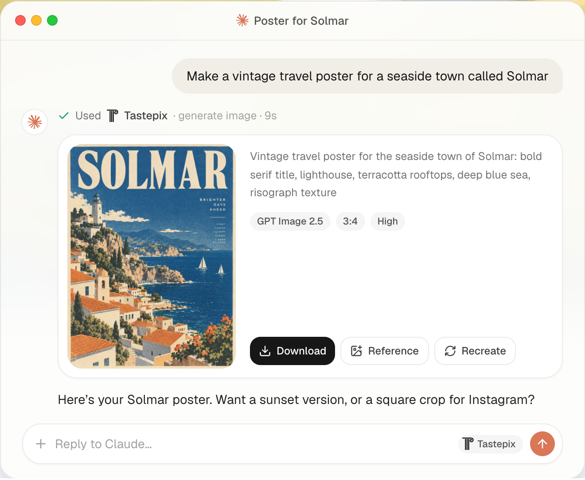
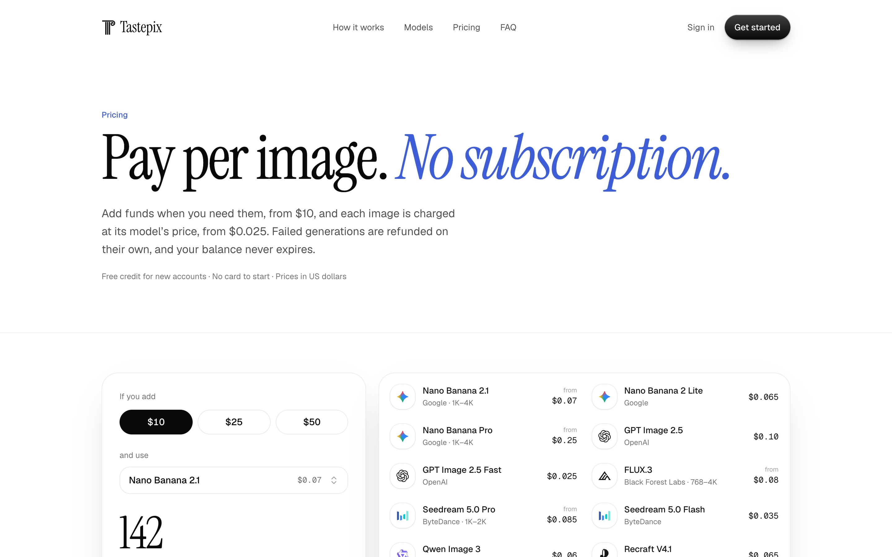
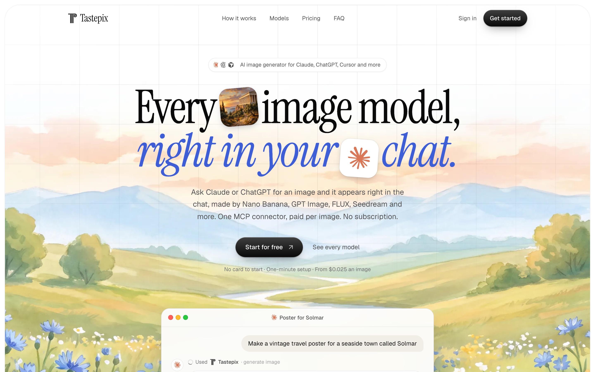

<p align="center">
  
</p>

<h1 align="center">Tastepix MCP</h1>

[](https://smithery.ai/servers/pablobellobarcon/tastepix)
[](https://glama.ai/mcp/connectors/io.github.paablobello/tastepix)
[](https://lobehub.com/mcp/paablobello-tastepix-mcp)

<p align="center">
  <b>Every image model, right in your chat.</b><br />
  A hosted MCP server that adds image generation and editing to Claude, ChatGPT, Claude Code, Cursor and Codex.<br />
  12 top models, background removal, upscaling, SVG vectorizing and image-to-video. Pay per image, no subscription.
</p>

<p align="center">
  <a href="https://tastepix.com/?ref=github">Website</a> ·
  <a href="https://tastepix.com/pricing?ref=github">Pricing</a> ·
  <a href="#connect">Connect</a> ·
  <a href="#tools">Tools</a> ·
  <a href="#models">Models</a> ·
  <a href="#faq">FAQ</a>
</p>

<p align="center">
  
</p>

---

## What it is

Tastepix is a **remote MCP server** (Model Context Protocol). Connect it once to your AI app, then
ask for images in plain language: *"make a vintage travel poster for a seaside town"*, *"remove the
background"*, *"upscale it 4×"*, *"animate this"*. The assistant picks the model, the image appears
inline in the chat with download, reference and edit actions, and everything you make lands in one
gallery at [tastepix.com](https://tastepix.com/?ref=github).

- **No API keys.** Sign in with Google or email; Tastepix handles the providers.
- **Many models, one account.** Ask for a model by name or let the assistant choose.
- **Works where you already work.** Claude (web, desktop, mobile), ChatGPT, Claude Code, Cursor, Codex.
- **Pay per image.** Prepaid balance, no subscription, balance never expires, failed generations are refunded automatically. New accounts get a small free credit.

**Server URL**

```
https://mcp.tastepix.com/mcp
```

Transport: Streamable HTTP. Auth: OAuth 2.1 (the app opens a Tastepix sign-in page the first time).

## Connect

<table>
<tr><td width="140"><b>Claude</b><br/>web · desktop · mobile</td><td>

[**Add to Claude**](https://claude.ai/customize/connectors?modal=add-custom-connector&connectorName=Tastepix&connectorUrl=https%3A%2F%2Fmcp.tastepix.com%2Fmcp) — Claude opens with Tastepix filled in: click **Continue**, then **Connect**, then **Allow** on the Tastepix page.<br/>
Manually: Settings → Connectors → *Add custom connector* → paste the server URL.

</td></tr>
<tr><td><b>Claude Code</b></td><td>

As a plugin, with the server and the Tastepix skill together:

```
/plugin marketplace add paablobello/tastepix-mcp
/plugin install tastepix@tastepix
```
Or the server alone:

```bash
claude mcp add --transport http --scope user tastepix https://mcp.tastepix.com/mcp
```
Then in Claude Code type `/mcp`, pick **tastepix** and sign in.

</td></tr>
<tr><td><b>Cursor</b></td><td>

[](https://cursor.com/install-mcp?name=Tastepix&config=eyJ1cmwiOiJodHRwczovL21jcC50YXN0ZXBpeC5jb20vbWNwIn0%3D)<br/>Cursor opens with Tastepix filled in: click **Install**, then **Connect** and **Allow**.<br/>
Manually, in `~/.cursor/mcp.json`:

```json
{ "mcpServers": { "tastepix": { "url": "https://mcp.tastepix.com/mcp" } } }
```

</td></tr>
<tr><td><b>Codex</b></td><td>

```bash
codex mcp add tastepix --url https://mcp.tastepix.com/mcp
codex mcp login tastepix
```
In the Codex app: Settings → MCP servers → Add server → Streamable HTTP, with the server URL.<br/>
As a plugin with the skill: `codex plugin marketplace add paablobello/tastepix-mcp`, then install **tastepix** from `/plugins`.

</td></tr>
<tr><td><b>Gemini CLI</b></td><td>

```bash
gemini extensions install https://github.com/paablobello/tastepix-mcp
```
Installs the server with the Tastepix context and skill. The first Tastepix call opens the sign-in.

</td></tr>
<tr><td><b>VS Code</b></td><td>

[**Add to VS Code**](https://insiders.vscode.dev/redirect/mcp/install?name=tastepix&config=%7B%22type%22%3A%22http%22%2C%22url%22%3A%22https%3A%2F%2Fmcp.tastepix.com%2Fmcp%22%7D) — VS Code opens with Tastepix filled in: click **Install**, then sign in.<br/>
From a terminal:

```bash
code --add-mcp '{"name":"tastepix","type":"http","url":"https://mcp.tastepix.com/mcp"}'
```

</td></tr>
<tr><td><b>ChatGPT</b></td><td>

On chatgpt.com (in a browser): open [chatgpt.com/plugins](https://chatgpt.com/plugins) → **Add** → *Create MCP App* → name it **Tastepix**, paste the server URL, choose **OAuth** → **Create**, then **Allow** on the Tastepix page. In a new chat, type `@Tastepix`. It then shows up in the ChatGPT apps too.

</td></tr>
<tr><td><b>Other MCP clients</b></td><td>

Any client that supports remote MCP servers over Streamable HTTP with OAuth: add `https://mcp.tastepix.com/mcp`.

</td></tr>
<tr><td><b>Skill</b><br/>any agent</td><td>

A short guide that helps agents use the Tastepix tools well (already included in the plugins and the Gemini extension):

```bash
npx skills add paablobello/tastepix-mcp
```

</td></tr>
</table>

> Client menus change often. The always-current steps for each app are in your dashboard under **Connect an app**.
> Setting it up with a coding agent? Point it at [llms-install.md](llms-install.md).

## Tools

| Tool | What it does |
|---|---|
| `generate_image` | Text-to-image and image editing with any model in the catalog; up to several reference images (by asset id, public URL or upload), and up to 4 options in one call (`count`). Results render inline in a viewer. |
| `remove_background` | Cuts out the subject into a transparent PNG. |
| `upscale_image` | Faithful 2× or 4× upscale. |
| `vectorize_image` | Turns an existing image (logo, icon, flat artwork) into an SVG vector file. |
| `animate_image` | Turns an image into a short video with sound (returns at once; the viewer shows it when ready). |
| `get_video` | Checks on a video started with `animate_image`. |
| `list_models` | The catalog with what each model is best for and its price. |
| `show_images` | Shows existing images from your account inline. |
| `upload_images` | Inline drop zone so you can use local images as references in chat apps. |
| `request_upload` | Upload URL for clients that can run code (e.g. Claude Code, Codex). |


## Models

| Model | Maker | Best for |
|---|---|---|
| Nano Banana 2.1 *(default)* | Google | Fast all-rounder; strong at editing and multi-image composition |
| Nano Banana 2 Lite | Google | Quick drafts with the Google look |
| Nano Banana Pro | Google | Highest fidelity: infographics, dense text, 4K |
| GPT Image 2.5 | OpenAI | Precise prompt following, detailed scenes and text |
| GPT Image 2.5 Fast | OpenAI | Cheap everyday GPT Image |
| FLUX.3 | Black Forest Labs | Photorealism and aesthetic control |
| Seedream 5.0 Pro | ByteDance | Commercial and product shots, precise edits |
| Seedream 5.0 Flash | ByteDance | Cheapest fast photoreal drafts |
| Qwen Image 3 | Alibaba | Small and multilingual text, posters |
| Recraft V4.1 | Recraft | Design and illustration |
| Recraft V4.1 Vector | Recraft | Logos, icons and vector art (SVG download) |
| Grok Imagine 2.0 | xAI | Bold, stylized images |

Plus **background removal**, **2×/4× upscale**, **SVG vectorizing** and **image-to-video** (Grok Imagine Video, 720p).

## Pricing

Pay per image from a few cents, charged from a prepaid balance (EUR with VAT included in the EU,
USD elsewhere). No subscription, no expiry, failed generations refunded automatically.
**Current prices for every model and size: [tastepix.com/pricing](https://tastepix.com/pricing?ref=github).**

<p align="center">
  
</p>

## Examples

Just ask in your chat:

- *"Make a hero image for my landing page: a calm meadow at dawn, wide 16:9."*
- *"Use Nano Banana Pro to make an infographic of these numbers."*
- *"Remove the background from the product photo I just uploaded."*
- *"Make a logo for 'Solmar' as an SVG with Recraft Vector."*
- *"Upscale that last image 4× and then animate it, slow camera push-in."*
- In Claude Code or Cursor: *"Generate an OG image for this site and save it to `public/og.png`."*

## FAQ

**Do I need API keys from OpenAI, Google, etc.?** No. One Tastepix account covers every model.

**Can Claude generate images on its own?** Claude doesn't generate images natively; Tastepix adds that through MCP, inline in the chat.

**Is there a subscription?** No. You add funds when you want and pay per image. New accounts get a small free credit to try it.

**What happens if a generation fails?** It's refunded to your balance automatically.

**Where do my images go?** They're shown in the chat and saved to your private gallery at tastepix.com, from every app you use. You can delete them, or your whole account, from the dashboard.

**Privacy?** See the [privacy policy](https://tastepix.com/privacy?ref=github) and [terms](https://tastepix.com/terms?ref=github).

## About this repository

This repository holds the public documentation and registry metadata for the hosted Tastepix MCP
server (`server.json` for the [Official MCP Registry](https://registry.modelcontextprotocol.io)), plus
the plugin and extension manifests for Claude Code, Cursor, Codex and Gemini CLI and the `tastepix`
skill. They contain only configuration and Markdown: no scripts, hooks or code run on install.
The server itself is a hosted service; its source is not published here.

Support: [hola@tastepix.com](mailto:hola@tastepix.com) · Issues and feedback: open an issue in this repository.

<p align="center">
  <a href="https://tastepix.com/?ref=github"></a>
</p>
